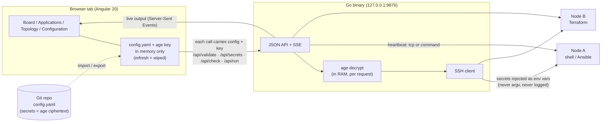

# cloud-ictneo2: stateless launcher console

[](https://github.com/GhislainAdon/cloud-ictneo2/actions/workflows/ci.yml)


[](LICENSE)

> A white-label web console to declare and **run shell / Ansible / Terraform jobs on remote nodes over SSH**, with **age-encrypted secrets** and **zero server-side state**. The whole "database" is a YAML file you own and can version; the decryption key lives only in the browser tab's memory.

[Résumé en français](#résumé-en-français) · [Documentation complète en français](docs/README.fr.md)

---

## The problem

Ops teams often keep a folder of "run this on that box" scripts plus a password manager entry for every secret those scripts need. Handing this to a colleague means sharing credentials in chat. Full-blown tools (Rundeck, AWX, Semaphore) bring a database, users and a server to maintain, which is too heavy for a small team or a lab.

cloud-ictneo2 sits in between:

- **one portable `config.yaml`** describes nodes, applications (commands + input fields + health checks) and **secrets encrypted with age**, so it is safe to commit;
- **one age key** decrypts them, in RAM only, per request;
- **one stateless Go binary** serves the UI and the API, keeps nothing on disk, and streams command output live.

## Architecture



## Features

- **Stateless by design**: no DB, no session store. Every API call carries its own config and key.
- **age / SOPS-style secrets**: `secret` fields are encrypted server-side with your age recipient. They are decrypted only in RAM at run time and injected as **environment variables**, so they never appear in `argv` or `ps aux` and are never logged.
- **Tile board** inspired by homarr: one tile per application, drag-and-drop ordering, resizable tiles, per-tile emoji icon and colour (persisted back into the YAML `tile:` block), **one-click run** with input prompts and **live SSE output**.
- **Health checks** per app: `tcp` reachability or a custom `command` (`systemctl is-active …`), configurable period, on/off.
- **Multi-project** workspaces with a header project switcher and shared secrets. Older single-project files are still accepted.
- **Form ⇄ code editor**: edit apps/nodes/secrets through forms, or switch to raw YAML with two-way sync and validation.
- **Read-only topology map** (SVG): which app runs on which node and which secrets it uses.
- **White-label**: displayed platform name comes from `platform.name`.
- **Hardened container**: multi-stage build, non-root user, bound to localhost by default.

## Quickstart

```bash
git clone https://github.com/GhislainAdon/cloud-ictneo2.git && cd cloud-ictneo2
docker compose up --build            # UI + API on http://127.0.0.1:9876

# 30-second demo: throwaway age key + pre-encrypted config
./examples/encrypt-demo.sh           # writes examples/config.encrypted.yaml, prints AGE-SECRET-KEY-...
```

Open http://127.0.0.1:9876 → **Configuration** → load `examples/config.encrypted.yaml` and paste the printed demo key → go to **Board**.

Minimal `config.yaml`:

```yaml
platform: { name: "My Datacenter" }
nodes:
  - { name: node-01, host: 10.0.0.5, user: admin, auth: { type: key, secretRef: ssh_key } }
applications:
  - name: terraform-apply
    node: node-01
    workdir: /opt/infra
    command: "terraform apply -auto-approve"
    fields:
      - { env: TF_VAR_password, label: "Password", type: secret, secretRef: tf_pass }
      - { env: TF_VAR_region,   label: "Region",   type: text,   default: eu-west-1 }
    check: { enabled: true, type: tcp, periodSeconds: 30 }
secrets:
  ssh_key: "-----BEGIN AGE ENCRYPTED FILE-----..."   # encrypted from the UI
  tf_pass: "-----BEGIN AGE ENCRYPTED FILE-----..."
```

### API

| Endpoint | Purpose |
|---|---|
| `GET /api/health` | Liveness |
| `POST /api/validate` | Parse + validate a `config.yaml` |
| `POST /api/secrets` | Encrypt a value for the loaded age key → armored blob |
| `POST /api/check` | Heartbeat (`tcp` / `command`) per app |
| `POST /api/run` | Decrypt in RAM, SSH, inject secrets as env, **stream output over SSE** |

### Development

```bash
# Backend
cd backend && go test ./... && go run ./cmd/launcher --listen 127.0.0.1:9876 --static ""   # API only
# Frontend (proxies /api to :9876)
cd frontend && npm ci && npx ng serve --proxy-config proxy.conf.json
```

No local toolchain? The French docs show the same commands run through `golang` and `node` containers.

## Screenshots

> _Placeholders, to be added (see [docs/screenshots](docs/screenshots/))._

| Board | Applications (form ⇄ code) | Topology | Live run output |
|---|---|---|---|
| `docs/screenshots/board.png` | `docs/screenshots/apps.png` | `docs/screenshots/topology.png` | `docs/screenshots/run-output.png` |

## Tech stack

- **Backend**: Go 1.26, `filippo.io/age`, `golang.org/x/crypto/ssh`, `gopkg.in/yaml.v3`, standard-library HTTP + Server-Sent Events
- **Frontend**: Angular 20 (standalone components, signals), TypeScript
- **Packaging**: multi-stage Dockerfile (node → go → alpine, non-root), docker compose
- **CI**: GitHub Actions with gofmt, `go vet`, `go test -race`, golangci-lint, Angular production build, Docker build and a Trivy image scan

## Security model

- **No authentication by design** (local operator tool). The server binds to `127.0.0.1` and the compose file publishes on localhost only. Put an authenticating reverse proxy in front before any network exposure.
- The age key is **never written** to disk or `localStorage`.
- Secrets are never logged and never passed on the command line.
- SSH host keys are not pinned (operator-declared nodes). This is a known limitation, listed on the roadmap.

## Roadmap

- [ ] SSH host-key pinning (`known_hosts` per node in the YAML)
- [ ] Optional OIDC login (reverse-proxy headers or built-in) for shared deployments
- [ ] Run history export (JSON) and per-run audit trail
- [ ] Native SOPS file format compatibility (encrypt/decrypt with `sops` CLI interchangeably)
- [ ] Frontend unit tests in CI (headless Chrome) and Playwright end-to-end smoke test
- [ ] Signed multi-arch images published to GHCR

## Design docs

- Spec: [docs/specs/2026-07-03-launcher-design.md](docs/specs/2026-07-03-launcher-design.md)
- Implementation plan: [docs/plans/2026-07-03-launcher-implementation.md](docs/plans/2026-07-03-launcher-implementation.md)

---

## Résumé en français

**cloud-ictneo2** est une console web **sans état**, en marque blanche, pour déclarer et lancer des scripts **shell / Ansible / Terraform** sur des nœuds distants via SSH. Tout l'état tient dans un `config.yaml` versionnable, dont les secrets sont **chiffrés avec age**. La clé age reste uniquement en mémoire de l'onglet. Le backend Go déchiffre les secrets en RAM et les injecte en **variables d'environnement**, jamais dans argv. La sortie des commandes est diffusée en direct (SSE). L'interface Angular propose un board de tuiles façon homarr, un éditeur formulaire ⇄ YAML, une carte de topologie et le multi-projet. Documentation détaillée : [docs/README.fr.md](docs/README.fr.md).

## License

[MIT](LICENSE) © Ghislain Adon
